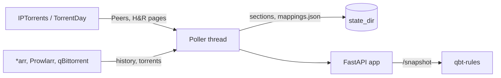

# Architecture Internals

## Overview

This page maps the codebase: which module does what, and how one polling cycle moves through them. For the user-facing view of the same flow, see [How It Works](How-It-Works).

One process: `trackie serve` runs uvicorn with the FastAPI app (`api.py`). The app's lifespan builds the matcher and the `Poller` from the configuration and starts the poller's daemon thread, which fetches each tracker's pages, keeps the last good data on disk and matches records to qBittorrent hashes. HTTP requests only read the poller's in-memory state, under locks.

## Components

| Module | Responsibility |
|--------|-----------------|
| `cli.py` | The `trackie` command (Typer): `serve` runs uvicorn with the app, `config` prints the effective settings, `version` |
| `api.py` | The FastAPI app: `create_app(config, poller=None)`, its lifespan (builds, starts and stops the poller), `/snapshot`, `/health`, `/readyz`, `/version`, and the JSON response that writes exactly what Flask did |
| `schemas.py` | Pydantic models of `/snapshot` and `/health`: the OpenAPI schema and the contract the tests validate against |
| `config.py` | `SETTINGS` on interpose's settings engine (`_FILE` > env > file > default; see [In-Depth Configuration](In-Depth-Configuration)), the `Config` objects, and trackie's own rules (legacy layout, API key with URL). Secrets are interpose `Secret`s |
| `sites.py` | One `Site` per tracker: base URL, page paths, parser functions, default site rules, and the pattern that finds a tracker ID in a URL. **The only place tracker-specific facts live outside the parsers** |
| `parsers/models.py` | What parsers return: `PeerRow`, `HnrRow`, `AccountStats`, `PeersPage`, `HnrPage`, and `ParseError` |
| `parsers/common.py` | Shared parsing helpers: header-indexed columns, "session (lifetime)" cells, "to go" durations, the lxml-backed soup |
| `parsers/ipt.py`, `parsers/td.py` | One `parse_peers` and one `parse_hnr` per site, plus `parse_account` for the page header |
| `units.py` | Sizes (binary units) to bytes, durations to seconds, numbers with commas or `---` |
| `fetch.py` | `SiteClient`: cookie and User-Agent headers, the request gap, login/Cloudflare detection, H&R-then-Peers order, user ID discovery. Raises `AuthError` / `FetchError` |
| `snapshot.py` | Joins Peers and H&R rows into records with a status; builds account records; `assemble()` splits records into `torrents` and `unmatched` |
| `sources.py` | Read-only clients: `ArrClient` (Sonarr/Radarr/Readarr/Lidarr), `ProwlarrClient`, `QbtClient`. Paged, incremental history reads |
| `matching.py` | `Matcher`: the matching chain, announce host learning, and `MappingStore` (`mappings.json`) |
| `poller.py` | `Poller`: per-tracker schedule, backoff, the zero-row guard, last-good state, triggers matching, builds `/health` |
| `store.py` | `StateStore`: each tracker's last good section as `state/<tracker>.json`, written atomically |
| `__init__.py` | `__version__`, read from the installed package's metadata; see [Release Process](Release-Process) |

### Process model

One container, one uvicorn process. There is exactly **one** on purpose: the poller runs inside the process, and a second one would mean a second poller fetching the same pages. The endpoints are plain `def` functions, which FastAPI runs in its thread pool; the poller is a separate daemon thread that wakes every 30 seconds to see whether a tracker is due. The lifespan starts it, so building the app (as the tests do) starts nothing, and stops it on shutdown. `/readyz` reports whether the thread is alive.

## Data flow

1. `Poller.run_due()` finds a tracker whose `next_poll` has passed and calls `poll(key)`.
2. `SiteClient.fetch()` loads the Hit & Run page, hands it to `site.parse_hnr`, reads the user ID from the profile link, waits out the request gap, then loads and parses Peers. IPT splits Peers over pages of 100 (`PeersPage.next_page`), so `SiteClient` follows them with `&p=<n>`, a request gap before each, up to `MAX_PEERS_PAGES`, and keeps the first row of a torrent that shows up on two pages.
3. `check_plausible()` applies the zero-row guard against the previous section.
4. `snapshot.tracker_section()` turns the two pages into a plain-dict **section** (account plus records). Sections are JSON-ready, which is what makes persistence trivial.
5. `StateStore.save()` writes the section; the poller swaps it into the tracker's state under a lock.
6. `Poller.match()` passes every tracker's records to `Matcher.refresh()`: *arr histories, Prowlarr titles, the qBittorrent list, host learning, name matching, then `MappingStore.save()`. The report is published only once the pass completes.
7. On request, `Poller.snapshot()` calls `assemble()` with the current sections and the matcher, which looks up each record's mapping. `/health` reads the same state.

Any exception in steps 2-5 is caught per tracker and recorded as an `error_kind`, so one tracker's failure never stops another's, and nothing replaces good data. See [Polling and Failures](Polling-and-Failures).

## Design decisions

- **Fail loudly, serve safely.** Parsers raise rather than return empty; the poller catches and keeps the old data. "No rows" must be a deliberate, checked outcome.
- **Tracker facts in `sites.py` and the parsers only.** Everything downstream works on tracker-neutral rows and records.
- **No secrets in strings.** Exceptions are re-raised `from None` with a message built from safe parts; config objects have a custom `__repr__`.
- **No personal data out.** Parsers drop the user and IP columns; records and accounts never carry a user ID.
- **The JSON is a contract.** `/snapshot` and `/health` are written byte for byte as the Flask app wrote them, and the Pydantic models with `extra="forbid"` make a new field a deliberate change.
- **A missing cookie isn't fatal.** The service starts, serves what it has, and reports the tracker as `error_kind: config`.

The records behind these are in [docs/design/](https://github.com/andronics/trackie/tree/main/docs/design), indexed in its README. Rejected ideas are in [TODO.md](https://github.com/andronics/trackie/blob/main/TODO.md) under "Decided against".
